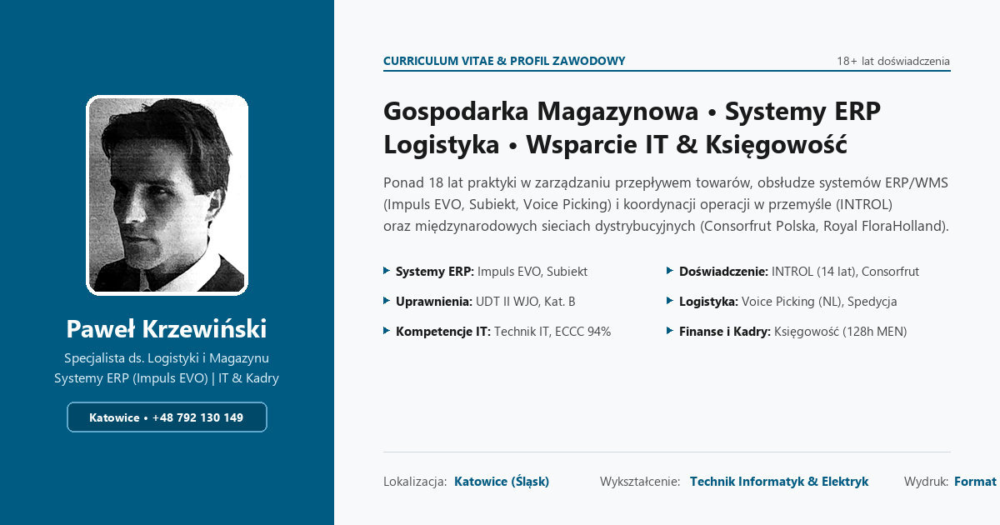

# Paweł Krzewiński — Specjalista ds. Gospodarki Magazynowej, Logistyki & Systemów ERP | CV

[](.github/workflows/deploy.yml)
[](tests/unit)
[](index.html)
[](SECURITY.md)

Oficjalne repozytorium interaktywnego Curriculum Vitae oraz generatora wydruków A4 PDF dla **Pawła Krzewińskiego** — Specjalisty ds. Gospodarki Magazynowej, Logistyki i Systemów ERP (**BPSC Impuls EVO**, **InsERT Subiekt**) z wykształceniem **Technika Informatyka (ŚTZN Katowice)** i **Technika Elektryka** oraz przygotowaniem z zakresu **księgowości, kadr i płac (128h MEN, program Płatnik)**.



---

## 🎯 Profil Kandydata w Pigułce

* **Staż zawodowy:** Ponad 18 lat doświadczenia w gospodarce magazynowej, intralogistyce, spedycji i wsparciu technicznym IT:
  * **Consorfrut Polska Sp. z o.o.:** Specjalista ds. Logistyki i Gospodarki Magazynowej (FMCG, kontrola jakościowa, awans płacowy 11.2022, certyfikowane szkolenie liderskie *„Budowanie zespołu”*).
  * **INTROL Sp. z o.o. (04.2015 – 09.2019 oraz 02.2005 – 10.2014 — łącznie ponad 14 lat):** Specjalista ds. Gospodarki Magazynowej / Magazynier (obsługa systemu ERP **BPSC Impuls EVO**, dokumentacja PZ/WZ/MM/RW/PW, automatyka przemysłowa i aparatura kontrolno-pomiarowa).
  * **Royal FloraHolland, Holandia (07.2014 – 03.2015):** Order Picker w największym na świecie centrum logistycznym branży florystycznej (kompletacja głosowa **Voice Picking / Pick-by-Voice**).
  * **Szpital Specjalistyczny w Chorzowie (06.2004 – 01.2005):** Informatyk / Pierwsza linia wsparcia technicznego (Helpdesk L1, serwis sprzętu PC, drukarek i sieci LAN).
* **Twarde uprawnienia i certyfikaty:**
  * **UDT kat. II WJO** (nr `39/02502/04`, Urząd Dozoru Technicznego w Katowicach) + kursy ZDZ Katowice (ISO 9001): *Pracownik obsługi magazynu z obsługą programu Subiekt i fakturowaniem* (181 godz.) oraz *Kierowca wózków jezdniowych* (67 godz.).
  * **Podstawy księgowości z elementami kadr i płac** (Zaświadczenie MEN nr `139/2019/BB`, **128 godzin**, w tym 94 godz. praktycznych i 34 godz. obsługi programu **Płatnik**).
  * **4 Europejskie Certyfikaty Kompetencji Cyfrowych ECCC (2019, śr. 94,25%):** Informacja (**100%**), Bezpieczeństwo IT (**97%**), Komunikacja (**93%**), Rozwiązywanie problemów (**87%**).
  * **Certyfikat Pierwszej Pomocy:** *Applying First Aid / Udzielanie Pierwszej Pomocy w Stanach Zagrożenia Życia* (Centrum Ratownictwa / Ośrodek Ratownictwa i Stanów Nagłych we Wrocławiu).
* **Wykształcenie techniczne:**
  * **Technik Informatyk** — Śląskie Techniczne Zakłady Naukowe (ŚTZN) w Katowicach (`2002–2004`).
  * **Technik Elektryk** — Technikum Elektryczno-Mechaniczne (`1997–2002`).

---

## 🏗️ Architektura Rozwiązania (Zero-Bloat & A4 Print-First)

Projekt został zbudowany na bazie wzorca architektonicznego `Moje-CV` / `_site-template`:
* **Semantyczny HTML5 + WCAG 2.2 + Schema.org (`Person` JSON-LD):** [index.html](index.html)
* **Arkusz ekranowy i responsywny (Mobile/Desktop):** [assets/css/main.css](assets/css/main.css)
* **Dedykowany arkusz wydruku formatu A4:** [assets/css/print.css](assets/css/print.css)
* **Zdjęcie profilowe i karta Open Graph:** [assets/images/photo.jpg](assets/images/photo.jpg) oraz [assets/images/og-preview.png](assets/images/og-preview.png)
* **Kompilator PDF (Headless Chromium):** [scripts/generate-pdf.js](scripts/generate-pdf.js) -> generuje `dist/Pawel_Krzewinski_CV.pdf`

---

## 💻 Komendy Deweloperskie

```bash
# 1. Uruchomienie wszystkich 96 testów jednostkowych
npm test

# 2. Pełna brama jakościowa (składnia JS + 96 testów jednostkowych)
npm run check

# 3. Kompilacja oficjalnego pliku PDF (dist/Pawel_Krzewinski_CV.pdf)
npm run build:pdf

# 4. Lokalny serwer podglądu (http://localhost:3000)
npm run serve
```
